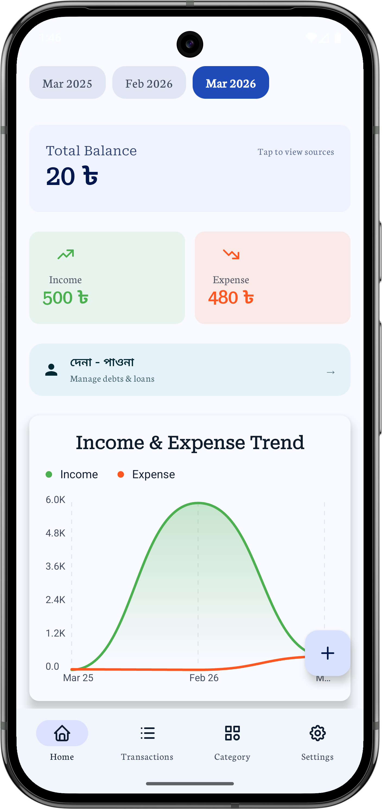
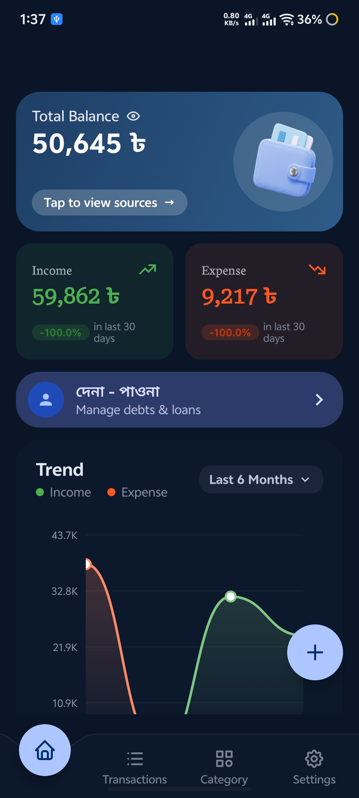
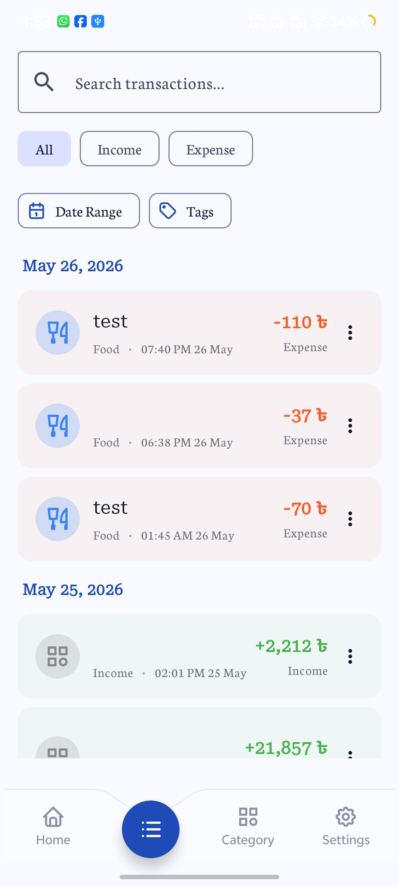
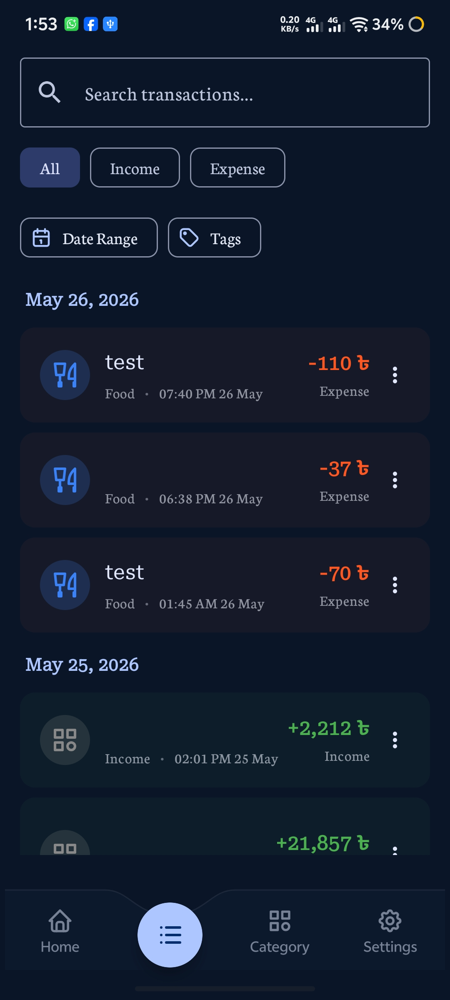
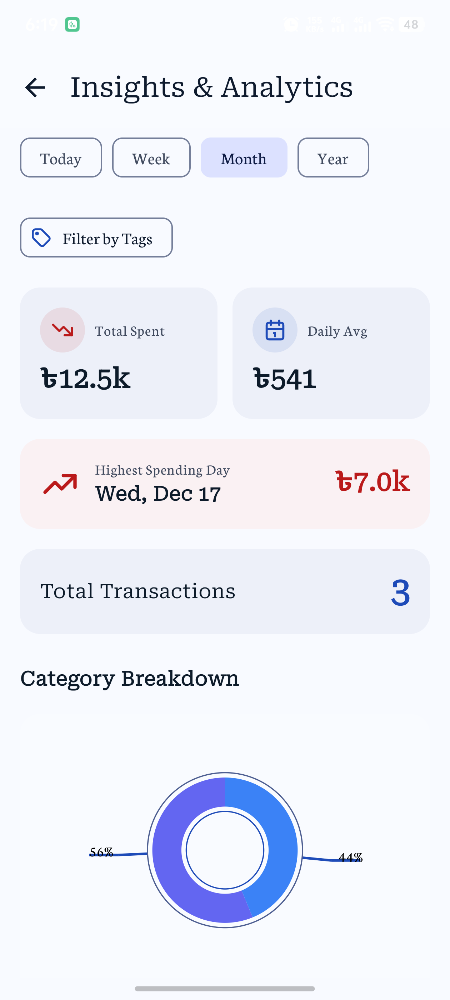
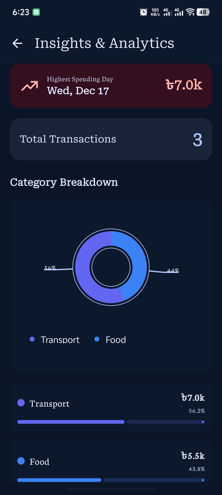
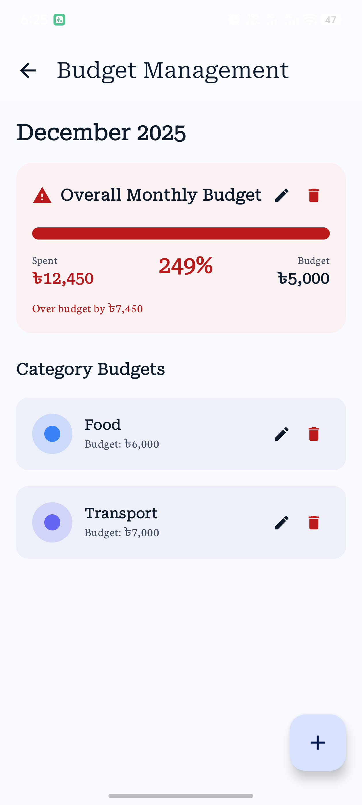
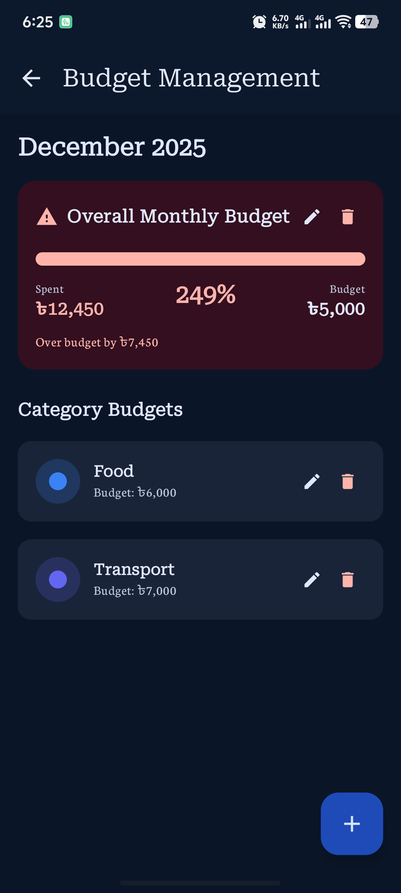
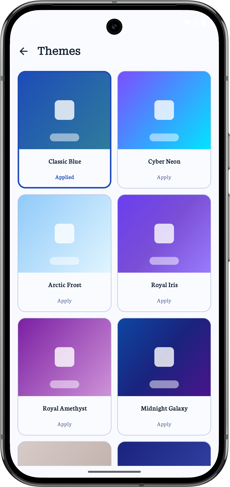
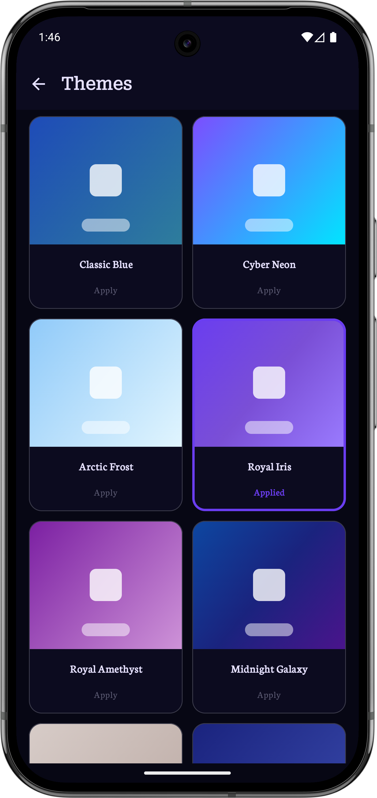

# 💰 Pocket Log — Expense Tracker

**Pocket Log is now available on the Google Play Store!** 🎉

We are excited to announce that Pocket Log has officially been published on the **Google Play Store**.

For the best experience, please download or update Pocket Log directly from Google Play. **All future updates, new features, improvements, and bug fixes will be delivered through the Play Store.**

The latest version brings an improved user interface, enhanced security, Google Drive Backup & Restore, and many other improvements to make personal finance management easier and more reliable.

  

  <b>Package Name:</b> <code>com.jihan.pocketlog</code>

---

## 📱 About Pocket Log

Pocket Log is a beautiful, modern, and feature-rich personal expense tracker built with **Jetpack Compose**.

Designed to help you manage your personal finances with ease, Pocket Log combines a clean Material 3 interface, powerful analytics, debt and loan management, budgeting, offline-first storage, and professional reporting — all while keeping your financial data private.

Whether you want to track daily expenses, manage multiple wallets, monitor budgets, or understand your spending habits, Pocket Log gives you the tools to stay in control of your money.

## 📸 Screenshots

### Home Screen

| Light Mode | Dark Mode |
|:---:|:---:|
|  |  |

---

### Transaction Screen

| Light Mode | Dark Mode |
|:---:|:---:|
|  |  |

---

### Analytics Screen

| Light Mode | Dark Mode |
|:---:|:---:|
|  |  |

---

### Budget Screen

| Light Mode | Dark Mode |
|:---:|:---:|
|  |  |

---

### Themes

| Light Mode | Dark Mode |
|:---:|:---:|
|  |  |

---

## ✨ What's New

- ☁️ **Google Drive Backup & Restore** — Back up your financial data to Google Drive and restore it whenever needed.
- 🎨 **Improved User Interface** — A refined and more polished user experience.
- 🔒 **Enhanced Security** — Improved app security and privacy protection.
- ⚡ **Performance Improvements** — A smoother and more reliable experience.
- 🛠️ **Bug Fixes & Improvements** — Various fixes and refinements.

**Note:** Future updates will be distributed through the Google Play Store.

---

## 🚀 Highlights

- 🎨 Beautiful Material 3 UI
- 🌙 Full Dark & Light Mode Support
- 📈 Interactive Animated Charts
- 📄 Professional PDF Reports
- 💰 Calculator-style Amount Input
- 🏦 Multiple Wallets & Balance Sources
- 🤝 Debt & Loan Management
- 📊 Budget Tracking & Smart Alerts
- 🔔 Reminder Notifications
- ☁️ Google Drive Backup & Restore
- 🗑️ 30-Day Trash & Restore
- 🔒 Offline-first & Privacy-focused

---

## 📋 Features

### 💰 Expense Tracking
- Income & Expense Management
- Calculator-style Amount Input
- Smart Search & Filters
- Custom Categories
- Multi-select & Bulk Delete
- 30-Day Trash & Restore

### 📊 Analytics
- Interactive Line Charts
- Expense Pie Charts
- Income vs Expense Overview
- Multiple Time Filters

### 💵 Budget Management
- Monthly Budgets
- Category Budgets
- Spending Progress
- Budget Alerts

### 🤝 Debt & Loan Management
- Profile-based Management
- Net Balance Tracking
- Lending & Borrowing History

### 🏦 Balance Sources
- Multiple Wallets & Accounts
- Balance Transfers
- Live Balance Calculation

### 📄 Export & Backup
- Professional PDF Reports
- PDF Preview
- CSV Export
- JSON Backup & Restore
- Google Drive Backup & Restore

### 🔔 Smart Features
- Transaction Reminders
- Budget Notifications
- Background Monitoring

### 🎨 UI & Experience
- Curved Animated Navigation
- Floating Navigation Bubble
- Material 3 Design
- Dark & Light Mode
- 16+ Premium Themes
- Beautiful Animations

### 🔒 Privacy & Security
- Offline-first Architecture
- PIN & Fingerprint Lock
- Secure Local Storage
- No account registration required for core offline functionality
- Your financial records remain stored locally unless you choose to use backup features.

---

## 🏗️ Tech Stack

| Technology | Implementation |
|---|---|
| Language | Kotlin |
| UI Framework | Jetpack Compose (Material 3) |
| Architecture | MVI + Clean Architecture |
| Dependency Injection | Koin |
| Database | Room |
| Navigation | Type-safe Compose Navigation |
| Background Tasks | WorkManager |
| Storage | DataStore |
| Serialization | Kotlinx Serialization |
| Charts | Custom Compose Canvas |
| PDF Generation | Android PdfDocument |
| Icons | Vecto Icons |

---

## 📥 Download

Pocket Log is officially available on the Google Play Store.

  

  <b>Always download the latest version from Google Play.</b>
   
  All future updates will be available there.

---

## 📄 License

This project is licensed under the **MIT License**.

See the [LICENSE](LICENSE) file for details.

---

## 📧 Contact

Have questions, suggestions, or found a bug?

- GitHub: https://github.com/0xJihan

Feel free to open an issue in this repository for bug reports and suggestions.

---

## ⭐ Support

If you find **Pocket Log** helpful, please consider giving this repository a ⭐ Star.

Your support helps the project grow and motivates further development.

**Thank you for supporting Pocket Log! ❤️**
